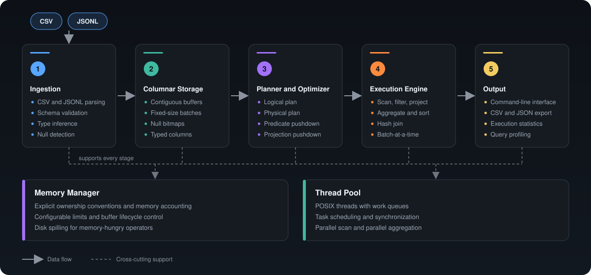
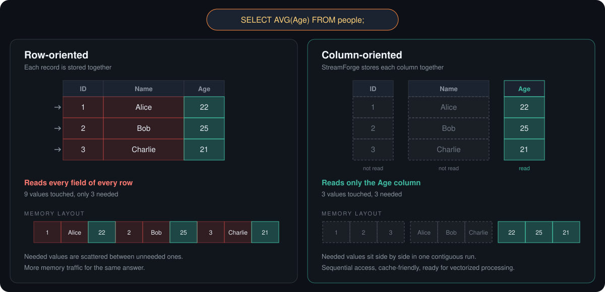
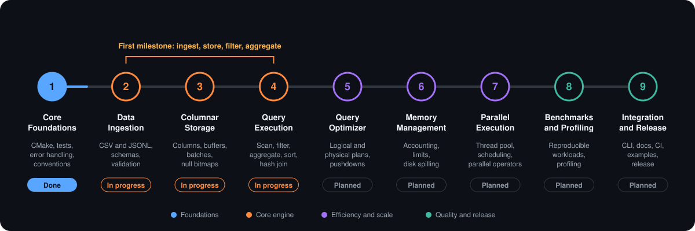

<p align="center">
  
</p>

<p align="center">
  
  
  
  
</p>

<p align="center">
  <a href="#why-streamforge">Why</a> &nbsp;·&nbsp;
  <a href="#architecture">Architecture</a> &nbsp;·&nbsp;
  <a href="#the-big-idea-columns-not-rows">Columnar</a> &nbsp;·&nbsp;
  <a href="#the-query-optimizer">Optimizer</a> &nbsp;·&nbsp;
  <a href="#benchmarking-philosophy">Benchmarks</a> &nbsp;·&nbsp;
  <a href="#roadmap">Roadmap</a> &nbsp;·&nbsp;
  <a href="#getting-started">Getting started</a>
</p>

---

> **Project status: early development.**
> StreamForge is being built in public, phase by phase. Everything in this README is marked as *Done*, *In progress*, or *Planned*. No planned feature is presented as finished, and no performance number will ever appear here without a reproducible benchmark behind it.

---

## At a glance

| | |
|---|---|
| **What** | An analytical data-processing engine written from scratch in C17 |
| **How** | Columnar storage, vectorized execution, a query optimizer, explicit memory control, multi-threading |
| **Why** | To understand, implement and measure what makes modern engines like DuckDB fast |
| **Not** | A wrapper, a toy script, or a claim of "faster than X" without proof |

---

## Why StreamForge?

Most of us use analytical engines as black boxes: `df.groupby(...)`, `SELECT SUM(...)`, and a result appears. But *why* is a columnar engine so much faster than a row-by-row loop? What does "vectorized execution" actually do to the CPU? When do more threads help, and when do they make things **slower**?

**StreamForge answers these questions the hard way: by building the machinery itself.**

It implements, in plain C, the core ideas behind modern systems such as DuckDB and Apache Arrow, from raw file ingestion to query execution, while staying an independent, educational, engineering-focused project.

### The problem

Analytical workloads hurt when data grows:

| Pain point | Why it hurts |
|---|---|
| **Row-oriented processing** | Reads every field even when a query needs 2 columns out of 50 |
| **Redundant data copies** | Burns memory bandwidth and RAM |
| **Unpredictable memory usage** | One big query can take the whole machine down |
| **Single-threaded execution** | Leaves modern multi-core CPUs idle |
| **Naive query execution** | Scans and computes things that could have been skipped |
| **Unreproducible benchmarks** | "It feels faster" is not a measurement |

StreamForge tackles each of these with a dedicated component, built and measured one at a time.

---

## Architecture

Five stages carry data from raw files to results, while a memory manager and a thread pool support every one of them.

<p align="center">
  
</p>

| Stage | Responsibility | Status |
|---|---|:--:|
| **Ingestion** | Parse CSV and JSONL, validate schemas, infer types, detect nulls, load in batches | Planned |
| **Columnar storage** | Typed columns over contiguous buffers, fixed-size batches, null bitmaps | Planned |
| **Planner and optimizer** | Logical and physical plans, predicate and projection pushdown | Planned |
| **Execution engine** | Scan, filter, projection, sort, aggregation, hash join, processed batch by batch | Planned |
| **Output** | CLI, CSV and JSON export, execution statistics | Planned |
| **Memory manager** | Ownership conventions, accounting, limits, disk spilling | Planned |
| **Thread pool** | Work queues, scheduling, parallel scan and aggregation | Planned |

---

## The big idea: columns, not rows

Analytical queries rarely need every field of a record. Storing each column contiguously means a query only touches the data it actually uses.

<p align="center">
  
</p>

This layout is also what makes **vectorized execution** possible: instead of pushing one record at a time through the whole pipeline, each operator processes a whole batch of values in a tight loop, which is friendly to CPU caches and compilers.

### Design sketch of the core types

> Illustrative only. The final API will evolve as the engine takes shape.

```c
typedef struct sf_column {
    sf_type_t  type;       /* INT64, FLOAT64, STRING, ...            */
    size_t     length;     /* number of values in this column        */
    void      *data;       /* contiguous buffer of values            */
    uint8_t   *validity;   /* null bitmap: 1 bit per value           */
} sf_column_t;

typedef struct sf_batch {
    size_t         num_rows;     /* a fixed batch size, e.g. 4096    */
    size_t         num_columns;
    sf_column_t  **columns;
} sf_batch_t;
```

---

## The query optimizer

Writing operators is only half the story. A good engine decides *what not to do*. StreamForge will translate a query into a logical plan, turn it into a physical plan, and apply rewrite rules before execution.

<p align="center">
  
</p>

Planned techniques: predicate pushdown, projection pushdown, basic cardinality estimation, and valid operator reordering.

---

## Memory and parallelism

**Memory management.** In C, memory is your problem. StreamForge treats that as a feature: explicit ownership conventions, memory accounting, configurable limits, buffer lifecycle management, and **disk spilling** so memory-hungry operators can move intermediate data to disk when RAM runs out.

**Parallel execution.** POSIX threads, a thread pool, work queues and task scheduling power parallel scans and parallel aggregation, with sequential and parallel modes side by side.

> The honest question is **does parallelism actually help, and when?** StreamForge measures synchronization overhead instead of assuming that more threads always means faster.

---

## Benchmarking philosophy

Performance claims without evidence are just marketing. StreamForge will ship with a **reproducible benchmark suite**:

- Same input data, same operations, documented configurations, repeated runs
- Compared against **DuckDB**, **Polars** and **pandas** as reference points
- Results reported **honestly**, including the workloads where StreamForge loses

| Dimension | What it measures |
|---|---|
| Ingestion | Time to load datasets |
| Filtering | Conditional selection speed |
| Aggregation | Grouping and numeric computation |
| Joins | Dataset combination cost |
| Sorting | Ordering large datasets |
| Memory | Peak consumption |
| Parallel scaling | Behavior across thread counts |
| Throughput | Data processed per unit of time |

*Results will appear here once the benchmark suite exists. Not before.*

---

## Roadmap

The project grows in nine phases, each producing something testable.

<p align="center">
  
</p>

> **First milestone (phases 2 to 4):** a small but *correct* engine that ingests a dataset, stores it in columnar form, runs a filter and an aggregation, and returns the right answer. Everything else builds on that.

<details>
<summary><b>Phase details</b></summary>

| Phase | Focus | Status |
|:--:|---|:--:|
| 1 | **Core foundations**: project structure, CMake, core types, error handling, logging, ownership conventions, test infrastructure | Done |
| 2 | **Data ingestion**: CSV and JSONL parsing, schemas, validation, batch loading | Planned |
| 3 | **Columnar storage**: columns, buffers, null representation, batches | Planned |
| 4 | **Query execution**: scan, filter, projection, sort, aggregation, hash join | Planned |
| 5 | **Query optimization**: logical and physical plans, pushdowns, cost estimation | Planned |
| 6 | **Memory management**: accounting, limits, batch execution, disk spilling | Planned |
| 7 | **Parallel execution**: thread pool, scheduling, parallel operators | Planned |
| 8 | **Benchmarking and profiling**: reproducible workloads, sequential vs. parallel | Planned |
| 9 | **Release**: CLI polish, docs, CI/CD, examples, optional Python bindings | Planned |

</details>

---

## Engineering standards

This project is meant to show disciplined systems programming, not just C syntax.

| Area | Tooling |
|---|---|
| Language | **C17** |
| Compilers | GCC, Clang |
| Build | CMake + Ninja |
| Tests | CTest + custom unit tests |
| Debugging | GDB |
| Memory analysis | Valgrind |
| Formatting | clang-format |
| Static analysis | clang-tidy + strict compiler warnings |
| Concurrency | POSIX threads |
| CI | GitHub Actions |

### Design principles

1. **Correctness before speed.** A fast wrong answer is worthless.
2. **Measure, then optimize.** Every optimization needs a benchmark that justifies it.
3. **Explicit ownership.** Every allocation has one clear owner and one clear release path.
4. **Small modules, clear boundaries.** Each component can be tested in isolation.
5. **Deterministic tests, reproducible builds.** Results must be repeatable by anyone.
6. **Decisions are documented.** Architectural choices get written down, with their trade-offs.

---

## Getting started

> *The build is not available yet. These are the target commands once Phase 1 lands.*

```bash
git clone https://github.com/Samah-boudallaa/streamforge.git
cd streamforge

cmake -S . -B build -G Ninja -DCMAKE_BUILD_TYPE=Release
cmake --build build
ctest --test-dir build --output-on-failure
```

### Target usage (design sketch, not implemented yet)

```bash
# Inspect a dataset's inferred schema
streamforge schema data/sales.csv

# Run an analytical query with execution statistics
streamforge query data/sales.csv \
  --filter "amount > 100" \
  --group-by region \
  --agg "sum(amount), count(*)" \
  --threads 8 \
  --stats

# Export the result
streamforge query data/sales.csv --agg "avg(amount)" --out result.json
```

---

## Project structure (planned)

```
streamforge/
├── assets/                # README images
├── include/streamforge/   # Public headers
├── src/
│   ├── ingest/            # CSV / JSONL parsers, schema, validation
│   ├── storage/           # Columns, buffers, batches, nulls
│   ├── exec/              # Scan, filter, aggregate, sort, join
│   ├── plan/              # Logical & physical plans, optimizer
│   ├── mem/               # Allocators, accounting, spilling
│   ├── parallel/          # Thread pool, scheduler
│   └── cli/               # Command-line interface
├── tests/                 # Unit, integration, stress tests
├── bench/                 # Reproducible benchmark suite
├── docs/                  # Architecture notes & decision records
├── LICENSE
└── CMakeLists.txt
```

---

## What StreamForge is, and isn't

| It is | It is not (initially) |
|---|---|
| A modular analytical engine written in C17 | A replacement for DuckDB, PostgreSQL or Spark |
| A hands-on implementation of database and systems concepts | A distributed database |
| A deep dive into memory, performance and concurrency | A full SQL-compatible DBMS |
| A platform for honest, reproducible performance experiments | A production-ready analytics platform |
| Built on its own storage and execution code | A wrapper around libraries that do the real work |

---

## Inspiration

Architectural ideas drawn from the analytical-engine world, notably **DuckDB** and **Apache Arrow**. StreamForge is an independent implementation and is not affiliated with either project.

## Contributing

The project is at its very beginning, so the architecture is still taking shape. Issues, ideas and feedback on design choices are welcome. Contribution guidelines will be added as the codebase stabilizes.

## License

Released under the [MIT License](LICENSE).

---

<p align="center">
  <b>Built to understand how fast data engines really work, by building one.</b><br>
  Star the repo to follow the forge as it heats up.
</p>
