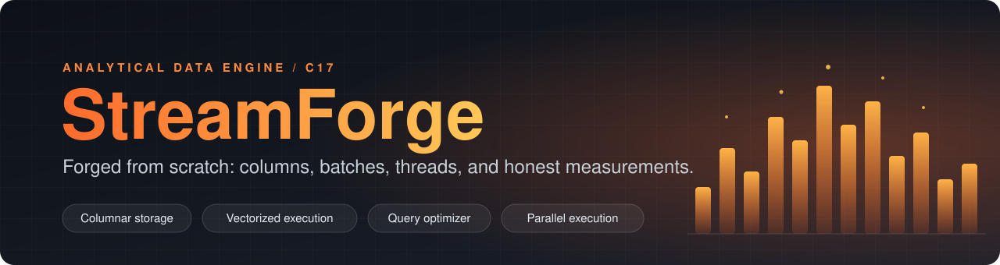
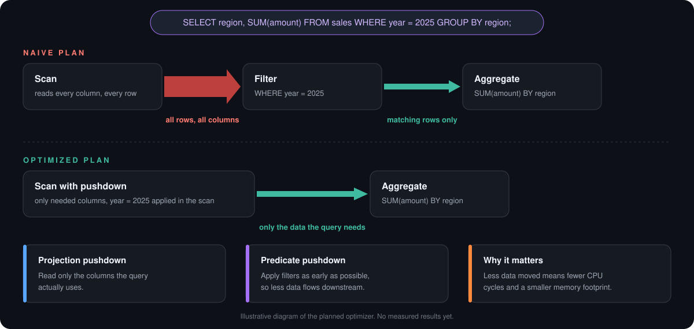

<p align="center">
  
</p>

<p align="center">
  
  
  
  
  <a href="https://github.com/Samah-boudallaa/streamforge/actions/workflows/ci.yml"></a>
</p>

<p align="center">
  <a href="#why-streamforge">Why</a> &nbsp;·&nbsp;
  <a href="#current-status">Status</a> &nbsp;·&nbsp;
  <a href="#try-it">Try it</a> &nbsp;·&nbsp;
  <a href="#architecture">Architecture</a> &nbsp;·&nbsp;
  <a href="#the-big-idea-columns-not-rows">Columnar</a> &nbsp;·&nbsp;
  <a href="#the-query-optimizer">Optimizer</a> &nbsp;·&nbsp;
  <a href="#benchmarking-philosophy">Benchmarks</a> &nbsp;·&nbsp;
  <a href="#roadmap">Roadmap</a>
</p>

---

> **Project status: early development.**
> StreamForge is being built in public, phase by phase. Everything in this README is marked as *Done*, *In progress*, or *Planned*. No planned feature is presented as finished, and no performance number will ever appear here without a reproducible benchmark behind it.

---

## At a glance

| | |
|---|---|
| **What** | An analytical data-processing engine written from scratch in C17 |
| **How** | Columnar storage, vectorized execution, a query optimizer, explicit memory control, multi-threading |
| **Why** | To understand, implement and measure what makes modern engines like DuckDB fast |
| **Not** | A wrapper, a toy script, or a claim of "faster than X" without proof |

---

## Why StreamForge?

Most of us use analytical engines as black boxes: `df.groupby(...)`, `SELECT SUM(...)`, and a result appears. But *why* is a columnar engine so much faster than a row-by-row loop? What does "vectorized execution" actually do to the CPU? When do more threads help, and when do they make things **slower**?

**StreamForge answers these questions the hard way: by building the machinery itself.**

It implements, in plain C, the core ideas behind modern systems such as DuckDB and Apache Arrow, from raw file ingestion to query execution, while staying an independent, educational, engineering-focused project.

### The problem

Analytical workloads hurt when data grows:

| Pain point | Why it hurts |
|---|---|
| **Row-oriented processing** | Reads every field even when a query needs 2 columns out of 50 |
| **Redundant data copies** | Burns memory bandwidth and RAM |
| **Unpredictable memory usage** | One big query can take the whole machine down |
| **Single-threaded execution** | Leaves modern multi-core CPUs idle |
| **Naive query execution** | Scans and computes things that could have been skipped |
| **Unreproducible benchmarks** | "It feels faster" is not a measurement |

StreamForge tackles each of these with a dedicated component, built and measured one at a time.

---

## Current status

What exists today, and what is next. This table is updated with every milestone.

| Component | Status | Notes |
|---|:--:|---|
| Core foundations | Done | Types, error handling, logging, configuration, versioning |
| Test infrastructure | Done | CTest, custom `CHECK` macro, Valgrind-clean tests, CLI end-to-end tests |
| CSV tokenizer | Done | Quoted fields, escaped quotes, CRLF and LF, embedded newlines, error reporting |
| Typed columns | Done | `INT64`, `FLOAT64`, `STRING`, null bitmap, amortized growth |
| Schema inference | Done | `INT64`, `FLOAT64`, `STRING` per column; `NULL`, `NA`, `N/A` and empty fields become nulls |
| CSV file loader | Done | File to typed table, with line-accurate parse errors |
| Aggregations | Done | `COUNT`, `SUM`, `MIN`, `MAX`, `AVG` over contiguous buffers, null-aware, overflow-checked |
| Command-line interface | In progress | `schema`, `head`, `agg` available; filtering and queries next |
| Filtering | Next | Row masks and aggregates over selected rows |
| Group by | Planned | Hash-based grouped aggregation |
| Batch-based execution | Planned | Fixed-size batches, the base of vectorized execution |
| First benchmarks | Planned | Reproducible workloads against pandas and DuckDB |

---

## Try it

**Requirements:** a C17 compiler (GCC or Clang), CMake 3.20 or newer, and Ninja. Valgrind is optional.

```bash
git clone https://github.com/Samah-boudallaa/streamforge.git
cd streamforge

cmake -S . -B build -G Ninja -DCMAKE_BUILD_TYPE=Debug
cmake --build build
ctest --test-dir build --output-on-failure
```

Explore the sample dataset:

```bash
./build/streamforge schema examples/sales.csv        # inferred column types and null counts
./build/streamforge head   examples/sales.csv 3      # first rows, as an aligned table
./build/streamforge agg    examples/sales.csv amount sum
```

```text
sum(amount) = 756.5
```

Supported aggregations are `count`, `sum`, `min`, `max` and `avg`. Nulls are ignored, an aggregation over no values returns `NULL`, and integer `SUM` reports an error on overflow instead of silently wrapping.

Check a test for leaks:

```bash
valgrind --leak-check=full --error-exitcode=1 ./build/test_column
```

### Where the CLI is heading (design sketch, not implemented yet)

```bash
# Filter, group and aggregate in parallel, with execution statistics
streamforge query data/sales.csv \
  --filter "amount > 100" \
  --group-by region \
  --agg "sum(amount), count(*)" \
  --threads 8 \
  --stats
```

---

## Architecture

Five stages carry data from raw files to results, while a memory manager and a thread pool support every one of them.

<p align="center">
  
</p>

| Stage | Responsibility | Status |
|---|---|:--:|
| **Ingestion** | Parse CSV and JSONL, validate schemas, infer types, detect nulls, load in batches | In progress |
| **Columnar storage** | Typed columns over contiguous buffers, tables, fixed-size batches, null bitmaps | In progress |
| **Planner and optimizer** | Logical and physical plans, predicate and projection pushdown | Planned |
| **Execution engine** | Scan, filter, projection, sort, aggregation, hash join, processed batch by batch | In progress |
| **Output** | CLI, CSV and JSON export, execution statistics | In progress |
| **Memory manager** | Ownership conventions, accounting, limits, disk spilling | Planned |
| **Thread pool** | Work queues, scheduling, parallel scan and aggregation | Planned |

---

## The big idea: columns, not rows

Analytical queries rarely need every field of a record. Storing each column contiguously means a query only touches the data it actually uses.

<p align="center">
  
</p>

This layout is also what makes **vectorized execution** possible: instead of pushing one record at a time through the whole pipeline, each operator processes a whole batch of values in a tight loop, which is friendly to CPU caches and compilers.

### The column type (implemented)

This is the actual in-memory representation used today (`include/streamforge/column.h`):

```c
typedef struct {
    sf_type_t type;
    size_t length;
    size_t capacity;      /* capacity in values */
    size_t null_count;
    uint8_t *validity;    /* bitmap, 1 = valid */
    void *data;           /* contiguous values, or string bytes */
    uint64_t *offsets;    /* STRING only: length + 1 entries */
    size_t data_size;     /* STRING only */
    size_t data_capacity; /* STRING only */
} sf_column_t;

sf_status_t sf_column_init(sf_column_t *column, sf_type_t type, sf_error_t *error);
sf_status_t sf_column_append_int64(sf_column_t *column, int64_t value, sf_error_t *error);
sf_status_t sf_column_append_null(sf_column_t *column, sf_error_t *error);
void        sf_column_destroy(sf_column_t *column);
```

Design choices: values live in one contiguous buffer, nulls are tracked in a separate bitmap (so a null never costs a sentinel value), and variable-width strings use an offsets array in the style of Apache Arrow.

A table owns a schema and one column per field, and is produced by the CSV loader:

```c
sf_table_t table;
sf_error_t err;

if (sf_csv_load_file("examples/sales.csv", NULL, &table, &err) == SF_STATUS_OK) {
    sf_scalar_t total;
    size_t idx;

    sf_table_find_column(&table, "amount", &idx);
    sf_agg_sum(&table.columns[idx], &total, &err);   /* total.as.f64 == 756.5 */

    sf_table_destroy(&table);
}
```

---

## The query optimizer

Writing operators is only half the story. A good engine decides *what not to do*. StreamForge will translate a query into a logical plan, turn it into a physical plan, and apply rewrite rules before execution.

<p align="center">
  
</p>

Planned techniques: predicate pushdown, projection pushdown, basic cardinality estimation, and valid operator reordering.

---

## Memory and parallelism

**Memory management.** In C, memory is your problem. StreamForge treats that as a feature: explicit ownership conventions, memory accounting, configurable limits, buffer lifecycle management, and **disk spilling** so memory-hungry operators can move intermediate data to disk when RAM runs out.

**Parallel execution.** POSIX threads, a thread pool, work queues and task scheduling power parallel scans and parallel aggregation, with sequential and parallel modes side by side.

> The honest question is **does parallelism actually help, and when?** StreamForge measures synchronization overhead instead of assuming that more threads always means faster.

---

## Benchmarking philosophy

Performance claims without evidence are just marketing. StreamForge will ship with a **reproducible benchmark suite**:

- Same input data, same operations, documented configurations, repeated runs
- Compared against **DuckDB**, **Polars** and **pandas** as reference points
- Results reported **honestly**, including the workloads where StreamForge loses

| Dimension | What it measures |
|---|---|
| Ingestion | Time to load datasets |
| Filtering | Conditional selection speed |
| Aggregation | Grouping and numeric computation |
| Joins | Dataset combination cost |
| Sorting | Ordering large datasets |
| Memory | Peak consumption |
| Parallel scaling | Behavior across thread counts |
| Throughput | Data processed per unit of time |

*Results will appear here once the benchmark suite exists. Not before.*

---

## Roadmap

The project grows in nine phases, each producing something testable.

<p align="center">
  
</p>

> **First milestone (phases 2 to 4):** a small but *correct* engine that ingests a dataset, stores it in columnar form, runs a filter and an aggregation, and returns the right answer. Loading, storage and aggregation are done; filtering is the last missing piece.

<details>
<summary><b>Phase details</b></summary>

| Phase | Focus | Status |
|:--:|---|:--:|
| 1 | **Core foundations**: project structure, CMake, core types, error handling, logging, ownership conventions, test infrastructure | Done |
| 2 | **Data ingestion**: CSV and JSONL parsing, schemas, validation, batch loading. *CSV tokenizer, schema inference and file loader done; JSONL and batch loading next.* | In progress |
| 3 | **Columnar storage**: columns, buffers, null representation, batches. *Typed columns and tables done; batches next.* | In progress |
| 4 | **Query execution**: scan, filter, projection, sort, aggregation, hash join. *Aggregations done; filter, group by, sort and join next.* | In progress |
| 5 | **Query optimization**: logical and physical plans, pushdowns, cost estimation | Planned |
| 6 | **Memory management**: accounting, limits, batch execution, disk spilling | Planned |
| 7 | **Parallel execution**: thread pool, scheduling, parallel operators | Planned |
| 8 | **Benchmarking and profiling**: reproducible workloads, sequential vs. parallel | Planned |
| 9 | **Release**: CLI polish, docs, CI/CD, examples, optional Python bindings | Planned |

</details>

---

## Engineering standards

This project is meant to show disciplined systems programming, not just C syntax.

| Area | Tooling | Status |
|---|---|:--:|
| Language | **C17**, extensions off | Done |
| Compilers | GCC, Clang | Done |
| Build | CMake + Ninja, `-Wall -Wextra -Wpedantic -Werror` | Done |
| Tests | CTest: unit tests and CLI end-to-end tests | Done |
| Memory analysis | Valgrind on every unit test, in CI | Done |
| CI | GitHub Actions: GCC and Clang, Debug and Release | Done |
| Formatting | clang-format | Done |
| Debugging | GDB | In use |
| Static analysis | clang-tidy | Planned |
| Concurrency | POSIX threads | Planned |

### Design principles

1. **Correctness before speed.** A fast wrong answer is worthless.
2. **Measure, then optimize.** Every optimization needs a benchmark that justifies it.
3. **Explicit ownership.** Every allocation has one clear owner and one clear release path.
4. **Small modules, clear boundaries.** Each component can be tested in isolation.
5. **Deterministic tests, reproducible builds.** Results must be repeatable by anyone.
6. **Decisions are documented.** Architectural choices get written down, with their trade-offs.

---

## Project structure

```
streamforge/
├── .github/workflows/     # CI: GCC and Clang, Debug and Release, Valgrind
├── assets/                # README images
├── benchmarks/            # Reproducible benchmark suite (planned)
├── docs/
│   ├── architecture/
│   ├── benchmarks/
│   ├── design-decisions/
│   └── development/
├── examples/              # Sample datasets (sales.csv)
├── include/streamforge/   # Public headers
├── scripts/
├── src/
│   ├── core/              # Types, errors, logging, config, version
│   ├── ingestion/         # CSV tokenizer, type inference, CSV loader
│   ├── storage/           # Typed columns with null bitmaps, tables
│   ├── execution/         # Aggregations (filter, group by, join planned)
│   ├── optimizer/         # Logical and physical plans, rewrite rules (planned)
│   ├── memory/            # Allocators, accounting, spilling (planned)
│   ├── parallel/          # Thread pool, scheduler (planned)
│   └── cli/               # Command-line tool: schema, head, agg
├── tests/
│   ├── unit/              # Unit tests and the shared CHECK macro
│   ├── integration/
│   └── stress/
├── CMakeLists.txt
├── CONTRIBUTING.md
└── LICENSE
```

---

## What StreamForge is, and isn't

| It is | It is not (initially) |
|---|---|
| A modular analytical engine written in C17 | A replacement for DuckDB, PostgreSQL or Spark |
| A hands-on implementation of database and systems concepts | A distributed database |
| A deep dive into memory, performance and concurrency | A full SQL-compatible DBMS |
| A platform for honest, reproducible performance experiments | A production-ready analytics platform |
| Built on its own storage and execution code | A wrapper around libraries that do the real work |

---

## Inspiration

Architectural ideas drawn from the analytical-engine world, notably **DuckDB** and **Apache Arrow**. StreamForge is an independent implementation and is not affiliated with either project.

## Contributing

The project is at an early stage, so the architecture is still taking shape. Issues, ideas and feedback on design choices are welcome. See [CONTRIBUTING.md](CONTRIBUTING.md) for the workflow.

## License

Released under the [MIT License](LICENSE).

---

<p align="center">
  <b>Built to understand how fast data engines really work, by building one.</b><br>
  Star the repo to follow the forge as it heats up.
</p>
